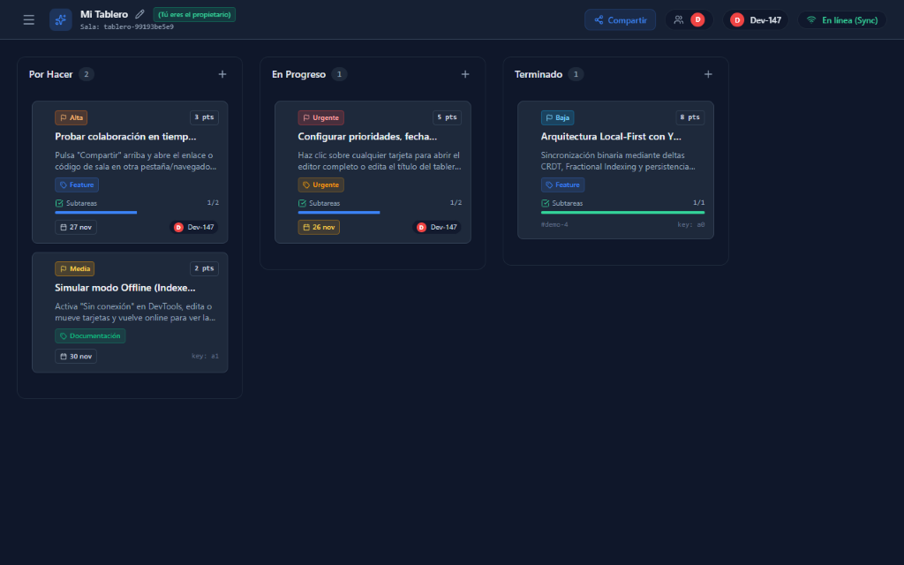
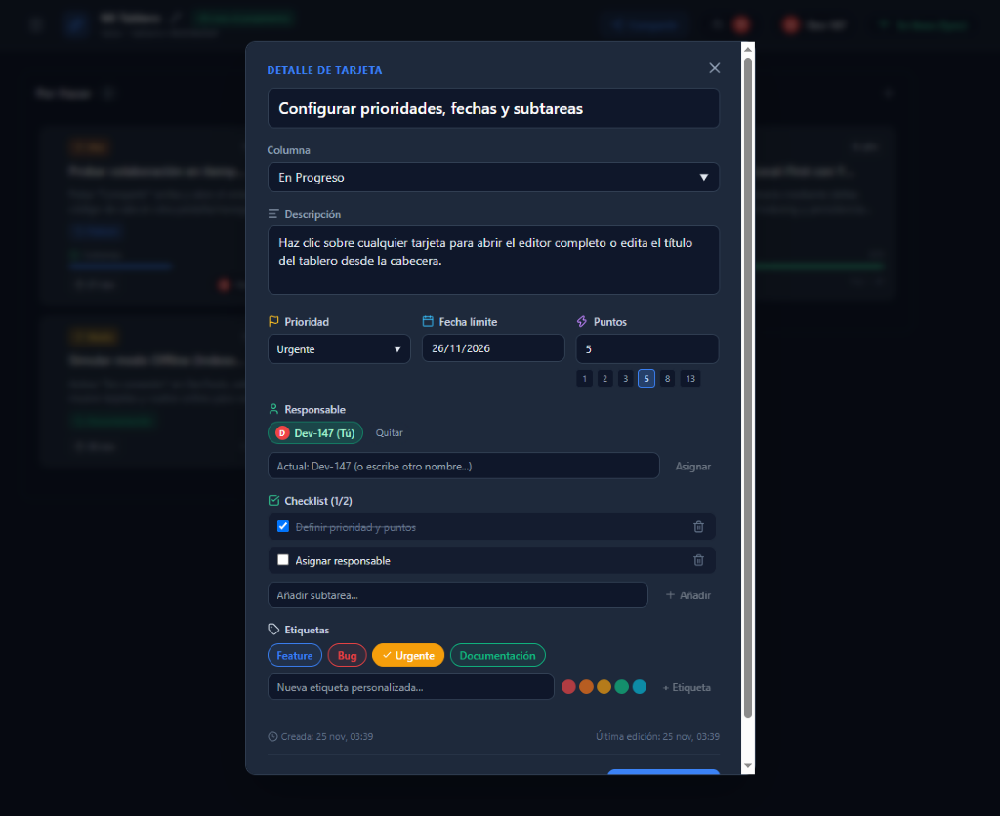
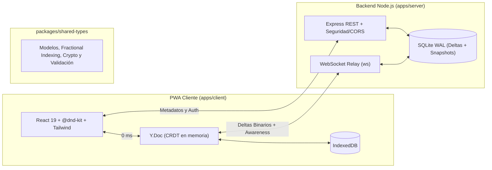

# 🗂️ Kanban Local-First Colaborativo (PWA + CRDT Yjs)

Aplicación **Kanban colaborativa en tiempo real y 100% funcional sin conexión**, diseñada bajo arquitectura **Local-First**. Las operaciones responden en **0 ms** sobre memoria/IndexedDB y convergen automáticamente entre múltiples usuarios mediante **CRDTs (Yjs)**, **Fractional Indexing** y **WebSockets binarios**.

[](https://kanban-local-first-one.vercel.app)


> **👉 Pruébalo ahora mismo:** **[https://kanban-local-first-one.vercel.app](https://kanban-local-first-one.vercel.app)**  
> *Tip para probar colaboración en vivo: pulsa **Compartir**, copia el enlace o el código rápido (`XXX-XXX`) y ábrelo en otra pestaña o dispositivo.*  
> *(Nota: el frontend está en Vercel 24/7 y el backend en Render Free. Si llevaba >15 min inactivo, la UI abre al instante desde IndexedDB y la sincronización en vivo tarda ~30–45 s en despertar).*

---

## 📸 Capturas de Pantalla

| Tablero Colaborativo en Tiempo Real | Editor Completo de Tarjeta |
| :---: | :---: |
|  |  |

---

## ✨ Decisiones de Ingeniería Destacadas

* **Latencia Local de 0 ms + Offline-First real:** la interfaz lee y muta un `Y.Doc` local persistido en **IndexedDB** (`y-indexeddb`), sincronizando deltas binarios al reconectar mediante `y-websocket`.
* **Resolución Determinista de Conflictos (`Edit-Wins` + `orderKey`):**
  * **Fractional Indexing en Base-62:** reordenar tarjetas con `@dnd-kit` genera claves intermedias sin reindexar toda la columna; ante colisiones concurrentes offline, `computeOrderKeyRepairs` las repara de forma determinista.
  * **Tombstones Edit-Wins:** si un usuario edita una tarjeta offline mientras otro la borra, la edición concurrente prevalece para evitar pérdida silenciosa de datos.
* **Presencia y Colaboración en Vivo:** cursores remotos normalizados al lienzo (*throttled* a ~25 FPS con `requestAnimationFrame`), insignias de actividad (`editando`, `creando`, `arrastrando`), actualización dinámica de responsables y limpieza inmediata de presencia al desconectarse.
* **Seguridad End-to-End sin Fricción de Login:**
  * Separación criptográfica entre `ownerToken` (renombrar/borrar) e `inviteToken` / código rápido `XXX-XXX` (colaborar), almacenados en SQLite como hashes **SHA-256** comparados con `crypto.timingSafeEqual`.
  * Credenciales WebSocket enviadas por `Sec-WebSocket-Protocol` y enlaces compartidos mediante fragmento `#` (limpiado inmediatamente con `history.replaceState`), protección **CSWSH**, **CSP**, **Rate Limiting** por IP y anti-resurrección de tableros eliminados.
* **PWA Instalable:** Service Worker con Workbox (`vite-plugin-pwa`) para carga instantánea y uso offline en escritorio y móvil.

---

## 🏗️ Arquitectura del Monorepo



```text
├── apps/
│   ├── client/              # PWA React 19 + Vite + @dnd-kit + Yjs + Workbox
│   └── server/              # Express + WebSockets (ws) + RoomManager + SQLite WAL
├── packages/
│   └── shared-types/        # Contratos TypeScript, Fractional Indexing, tokens y sanitizadores
├── Dockerfile               # Despliegue unificado multi-etapa Node 22 (PWA + API + WS)
├── render.yaml              # Blueprint para Render
└── fly.toml                 # Configuración con volumen persistente para Fly.io
```

---

## 🛠️ Stack Tecnológico

* **Frontend:** React 19, TypeScript, Vite, Tailwind CSS, `@dnd-kit/core` + `@dnd-kit/sortable`, `yjs`, `y-indexeddb`, `y-websocket`, `vite-plugin-pwa`.
* **Backend:** Node.js 22, Express, `ws`, `better-sqlite3` (modo WAL + compactación periódica de snapshots Yjs).
* **Calidad y Testing:** `node --test` (**34 tests** unitarios y de integración: motor Fractional Indexing, reconciliación offline, repositorio SQLite, CORS, CSWSH y rate limiting), `tsc --noEmit` y `oxlint`.

---

## 🚀 Arranque Rápido en Local

```bash
# 1. Instalar dependencias del monorepo
npm install

# 2. Compilar tipos compartidos
npm run build:types

# 3. Arrancar servidor (puerto 1234) y cliente (puerto 5173) en dos terminales
npm run dev:server
npm run dev:client
```

### Tests, Linting y Build de Producción

```bash
# Ejecutar los 34 tests (shared-types + server + client)
npm test

# Validación de tipos y linter
npm run typecheck && npm run lint

# Build completo de producción (PWA + Servidor)
npm run build
NODE_ENV=production TRUST_PROXY=false npm start
```

> También listo para producción con contenedor único mediante [`Dockerfile`](Dockerfile), [`render.yaml`](render.yaml) o [`fly.toml`](fly.toml). Consulta [`.env.example`](.env.example) para las variables disponibles.
